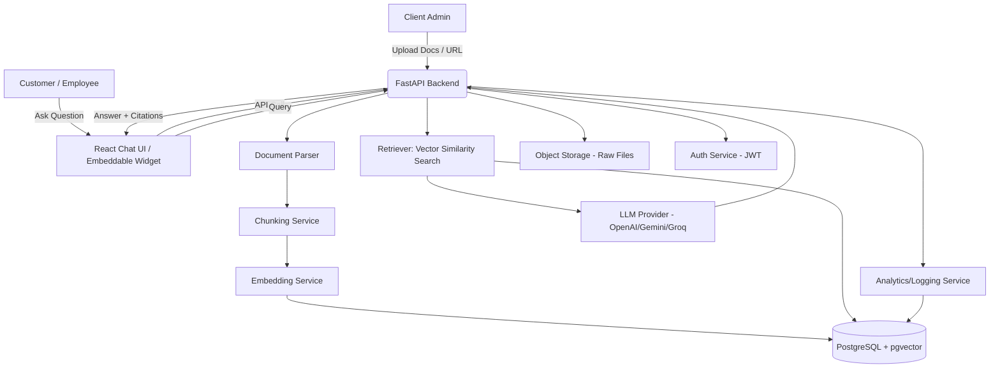

# Product Requirements Document (PRD)
## AI Customer Support Knowledge Assistant

**Version:** 1.0
**Status:** Draft
**Owner:** [Your Name]
**Last Updated:** September 2026

---

## 1. Executive Summary

### Problem Statement
Companies accumulate large volumes of unstructured knowledge — refund policies, product manuals, FAQs, onboarding docs, internal wikis — scattered across PDFs, Google Docs, Notion pages, and websites. Both employees and customers waste significant time manually searching this content to answer simple, repetitive questions. This creates support bottlenecks, inconsistent answers, and poor customer experience.

### Solution
A Retrieval-Augmented Generation (RAG) system that lets a company upload its documents once, then allows employees and/or customers to ask natural-language questions and receive accurate, cited answers pulled directly from that company's own knowledge base — not from general internet knowledge.

### Target Users
- **Primary buyers (clients who pay):** SaaS companies, e-commerce stores, educational businesses, agencies, and any support-heavy small-to-mid business.
- **End users of the tool:** Internal support agents, customer success teams, and (optionally, in a public-facing mode) the company's own customers.

### Value Proposition
- Reduces average time-to-answer from minutes to seconds.
- Reduces repetitive support ticket volume.
- Ensures answers are consistent and traceable to a real source document.
- Requires no ML expertise from the client — they upload documents and get a working assistant.

### Success Metrics (Business-Level)
- Reduction in average handling time (AHT) per support query.
- Reduction in repetitive/duplicate ticket volume.
- % of questions answered without human escalation.
- Client-reported time saved per week.

---

## 2. Goals & Non-Goals

### Goals (V1 Scope)
- Allow a company admin to upload documents (PDF, DOCX, TXT, HTML/URL) into a private knowledge base.
- Allow a user (internal or customer-facing, configurable) to ask questions in natural language.
- Return an answer grounded strictly in the uploaded documents, with a citation (document name + section/page).
- Support multiple isolated knowledge bases (multi-tenant: each client's data stays separate).
- Provide a simple admin dashboard to manage documents and view usage/analytics.
- Provide a simple chat widget/embeddable UI for the client's own website (stretch for V1, core for V2).

### Non-Goals (Explicitly Out of Scope for V1)
- Fine-tuning custom LLMs (V1 uses a hosted LLM API + retrieval, not model training).
- Multi-language translation of source documents (V1 assumes source and query language mostly match; basic multilingual embeddings are a stretch goal only).
- Voice/phone support integration.
- Full helpdesk/ticketing system replacement (this is a knowledge layer, not a full CRM/ticketing tool — though it can integrate with one later).
- Fully autonomous actions (e.g., actually issuing a refund). V1 only answers questions; it does not take transactional actions.
- On-premise/self-hosted deployment for clients (V1 is cloud-hosted SaaS only; self-hosting is a future enterprise-tier feature).

---

## 3. User Personas & Use Cases

### Persona 1: Support Agent ("Internal User")
- **Goal:** Answer customer questions quickly and accurately without digging through internal docs.
- **Use case:** Agent pastes/types a customer's question into the internal chat interface, gets an answer with a source link, copies/adapts it into their reply to the customer.

### Persona 2: End Customer ("External User")
- **Goal:** Get an immediate, accurate answer without waiting for a human.
- **Use case:** Customer visits company's website, opens the embedded chat widget, asks "Can I get a refund after 20 days?", gets an instant cited answer or a "please contact support" fallback if confidence is low.

### Persona 3: Company Admin / Knowledge Manager
- **Goal:** Keep the knowledge base current and monitor how well it's performing.
- **Use case:** Admin uploads a new policy PDF, removes an outdated FAQ, checks a dashboard showing top questions asked and any questions the AI failed to answer confidently (a "content gap" report).

### Persona 4: Freelancer/Agency Operator (You)
- **Goal:** Deploy this system for multiple clients efficiently and demonstrate ROI.
- **Use case:** You onboard a new client in under an hour by uploading their docs and configuring branding, then hand them login access.

---

## 4. Functional Requirements

| ID | Feature | Description | Priority | Acceptance Criteria |
|----|---------|-------------|----------|---------------------|
| F1 | Document Upload | Admin can upload PDF, DOCX, TXT files, or paste a URL to scrape. | P0 | File uploads successfully, is parsed, chunked, and embedded within a defined time (e.g., <2 min for a 50-page PDF). |
| F2 | Document Parsing & Chunking | System extracts text, preserves structure (headings/sections), splits into semantically coherent chunks. | P0 | Chunks retain enough context to be individually meaningful; section/page metadata is preserved per chunk. |
| F3 | Embedding & Indexing | Each chunk is embedded and stored in a vector database with metadata (source doc, section, page, upload date). | P0 | Vector search returns relevant chunks for a test query set with acceptable recall. |
| F4 | Question Answering (RAG) | User submits a natural language question; system retrieves top-k relevant chunks and generates an answer using an LLM constrained to those chunks. | P0 | Answer is grounded in retrieved content; system does not hallucinate facts not present in the docs. |
| F5 | Source Citation | Every answer includes a reference to the source document and, where possible, the specific section/page. | P0 | 100% of non-fallback answers include at least one traceable citation. |
| F6 | Low-Confidence Fallback | If retrieval confidence is low or no relevant chunk is found, respond with a safe fallback (e.g., "I couldn't find this in the documentation, please contact support") instead of guessing. | P0 | System does not fabricate answers when no relevant source exists. |
| F7 | Multi-Tenant Knowledge Bases | Each client's documents and chat history are isolated from other clients. | P0 | Client A cannot retrieve or see Client B's data under any query. |
| F8 | Admin Dashboard | View uploaded documents, delete/replace documents, view basic usage analytics (# queries, top questions, unanswered questions). | P1 | Admin can perform CRUD on documents and view a usage report. |
| F9 | Chat Interface (Internal) | Simple web chat UI for internal employees to query the knowledge base. | P0 | Functional chat UI with message history within a session. |
| F10 | Embeddable Widget (External) | A lightweight, brandable chat widget that can be embedded on a client's website via a script tag. | P1 | Widget loads on a test site and successfully answers a query. |
| F11 | Authentication & Access Control | Admin login (email/password or OAuth); role-based access (admin vs. agent). | P0 | Only authenticated admins can upload/delete documents. |
| F12 | Conversation History / Logging | Store past questions and answers per tenant for analytics and QA. | P1 | Logs are queryable and tied to the correct tenant. |
| F13 | Feedback Loop | Users can mark an answer as helpful/unhelpful; feedback is stored for later review. | P2 | Feedback is captured and visible in the admin dashboard. |
| F14 | Document Update/Versioning | Re-uploading a document replaces old chunks so answers stay current. | P1 | Old, outdated chunks are removed/superseded on re-upload. |

---

## 5. Non-Functional / Non-Technical Requirements

### Performance
- Answer generation latency target: under 4–6 seconds end-to-end for a typical query.
- Support concurrent queries from multiple users per tenant without significant degradation (target: 20+ concurrent users per tenant for V1 scale).

### Scalability
- Architecture should support onboarding new clients without re-architecting (multi-tenant from day one, even if V1 only has a handful of real clients).
- Vector database and document storage should scale horizontally as document volume grows per client.

### Security & Data Privacy
- All client documents and chat logs are encrypted at rest and in transit (TLS).
- Strict tenant data isolation — enforced at the database/query level, not just the application level.
- No client document data is used to train or fine-tune any shared/third-party model.
- If handling customer PII (e.g., in chat questions), define a data retention and deletion policy.
- Comply with relevant data protection regulations depending on client geography (e.g., GDPR for EU clients, CCPA for California-based clients).

### Compliance & Ethical Considerations
- Clearly disclose to end customers that they are interacting with an AI assistant, not a human (avoid deceptive UX).
- For any answer involving policy commitments (refunds, legal terms), include a disclaimer that the AI's answer should be verified against the official policy document for edge cases, to limit liability.

### Usability
- Admin document upload flow should require no technical knowledge (drag-and-drop, plain-language error messages).
- Chat UI should be simple, mobile-responsive, and match basic accessibility standards (readable contrast, keyboard navigation).

### Reliability / Availability
- Target uptime: 99% for V1 (single-region hosting is acceptable at this stage; multi-region is a future enterprise consideration).
- Graceful degradation: if the LLM API is down, show a clear "service temporarily unavailable" message rather than failing silently.

### Cost Constraints
- Architecture should minimize LLM API cost per query (e.g., via efficient retrieval, chunk-size tuning, and caching of repeated/common questions).
- Provide the client (or yourself, as operator) visibility into approximate cost-per-query for budgeting.

### Client Onboarding & Support
- Onboarding checklist: collect documents → upload → configure branding (widget colors/logo) → test with sample questions → go live.
- Define a basic support SLA (e.g., respond to client issues within 24–48 hours during V1/freelance stage).

### Legal
- Clarify in the client contract who is liable if the AI gives an incorrect or outdated answer (recommend a clear "AI-assisted, not legal/financial advice" disclaimer for sensitive domains).

---

## 6. Technical Requirements

### Recommended Tech Stack

| Layer | Technology | Justification |
|-------|-----------|----------------|
| Backend API | Python + FastAPI | Fast to build, async-friendly, great for AI/ML integrations, strong typing with Pydantic. |
| Database | PostgreSQL + pgvector extension | Combines relational data (users, tenants, documents metadata) and vector search in one database, simplifying ops for a solo/small team. |
| RAG Orchestration | LangChain or LlamaIndex | Handles chunking, retrieval pipelines, prompt templating; speeds up development significantly. |
| LLM Provider | OpenAI, Google Gemini, or Groq (configurable) | Allows cost/performance flexibility per client; abstracted behind an internal LLM interface so providers can be swapped. |
| Embeddings | OpenAI text-embedding-3-small/large, or an open-source alternative (e.g., BGE) via a hosted endpoint | Balance of cost and retrieval quality; should be swappable. |
| Frontend | React (with TypeScript recommended) | Component-based, widely supported, good ecosystem for chat UI libraries. |
| Widget | Lightweight React build compiled to a standalone embeddable JS bundle | Allows easy `<script>` embed on any client website. |
| Containerization | Docker + Docker Compose (local/dev); container hosting (e.g., a managed platform) for production | Consistent environments, easier client-specific deployment if ever needed. |
| Auth | JWT-based auth, optionally OAuth (Google login) for admin accounts | Simple, stateless, widely supported. |
| File Storage | Object storage (e.g., S3-compatible) for raw uploaded documents | Keeps raw files separate from parsed/embedded data; supports re-processing if needed. |

### Data Pipeline

1. **Ingestion:** Admin uploads a file or URL via the dashboard.
2. **Parsing:** Extract raw text (PDF via PyMuPDF/pdfplumber, DOCX via python-docx, HTML via BeautifulSoup), preserving section/page structure where possible.
3. **Chunking:** Split into overlapping semantic chunks (e.g., ~300–500 tokens with slight overlap), tagged with metadata (tenant_id, doc_id, source filename, page/section).
4. **Embedding:** Generate vector embeddings per chunk via the chosen embeddings model.
5. **Storage:** Store chunk text + metadata + embedding vector in PostgreSQL (pgvector column).
6. **Retrieval:** On a query, embed the user's question, run a similarity search (cosine/inner product) scoped to that tenant, retrieve top-k chunks.
7. **Generation:** Pass retrieved chunks + user question into a constrained prompt template sent to the LLM, instructing it to answer only from provided context and cite sources.
8. **Response:** Return the answer + citations to the frontend; log the interaction.

### Model / Retrieval Approach
- **Retrieval:** Dense vector similarity search (cosine similarity) via pgvector; optionally combine with keyword/BM25 hybrid search for better recall on exact terms (e.g., product names, numbers).
- **Grounding/Anti-hallucination:** System prompt explicitly instructs the LLM to answer only using retrieved context and to say "I don't know" / trigger the fallback if the answer isn't present.
- **Re-ranking (optional, V2):** A lightweight re-ranking step on top-k retrieved chunks to improve precision before generation.

### API Design (Core Endpoints Overview)

```
POST   /api/v1/auth/login
POST   /api/v1/auth/register

POST   /api/v1/tenants                     # create a client/tenant
GET    /api/v1/tenants/{tenant_id}

POST   /api/v1/documents/upload            # upload file
POST   /api/v1/documents/url                # ingest from URL
GET    /api/v1/documents                    # list documents for tenant
DELETE /api/v1/documents/{document_id}

POST   /api/v1/chat/query                   # main RAG Q&A endpoint
GET    /api/v1/chat/history

GET    /api/v1/analytics/usage
GET    /api/v1/analytics/unanswered
```

### Third-Party Integrations (Future/Optional)
- Helpdesk platforms (Zendesk, Intercom, Freshdesk) for ticket auto-suggestion.
- Slack/Teams bot integration for internal agent use.
- Shopify/website CMS integration for auto-syncing store policy pages.

---

## 7. System Architecture

### High-Level Architecture (Text Diagram)



### Data Flow Summary
1. Admin uploads document → parsed, chunked, embedded → stored in pgvector with tenant metadata.
2. User asks a question via chat UI or widget → question embedded → vector search scoped to tenant → top-k chunks retrieved.
3. Chunks + question sent to LLM with a grounding prompt → answer generated with citations.
4. Answer returned to UI; interaction logged for analytics.

---

## 8. API Requirements

### 8.1 General API Standards
- **Style:** RESTful JSON API, versioned via URL prefix (`/api/v1/...`) so breaking changes in the future don't affect existing client integrations (e.g., embedded widgets already deployed on client sites).
- **Format:** All requests/responses use `application/json`, except file uploads which use `multipart/form-data`.
- **Auth:** All endpoints except `/auth/login`, `/auth/register`, and the public widget query endpoint require a valid JWT Bearer token (`Authorization: Bearer <token>`).
- **Tenant scoping:** Every authenticated request resolves a `tenant_id` from the token; no endpoint accepts a client-supplied `tenant_id` for a resource it doesn't own. This is enforced at the query layer, not just checked in application logic.
- **Consistent error shape:**
```json
{
  "error": {
    "code": "DOCUMENT_NOT_FOUND",
    "message": "The requested document could not be found.",
    "request_id": "a1b2c3d4"
  }
}
```
- **Standard HTTP status codes:** 200/201 success, 400 validation error, 401 unauthenticated, 403 forbidden (cross-tenant access attempt), 404 not found, 422 unprocessable entity, 429 rate limited, 500 server error, 503 upstream (LLM provider) unavailable.
- **Pagination:** List endpoints support `?page=` and `?page_size=` query params, returning `{ "items": [...], "total": N, "page": N, "page_size": N }`.
- **Rate limiting:** Per-tenant and per-IP rate limits (e.g., 60 requests/min for `/chat/query`) to control LLM cost exposure and abuse; return `429` with a `Retry-After` header when exceeded.
- **Idempotency:** Document upload and tenant creation endpoints accept an optional `Idempotency-Key` header to prevent duplicate processing on retry.
- **Request tracing:** Every response includes a `request_id` for debugging/support purposes, logged server-side alongside the tenant_id.

### 8.2 Auth Endpoints

**`POST /api/v1/auth/register`**
- Body: `{ "email": str, "password": str, "company_name": str }`
- Response `201`: `{ "user_id": str, "tenant_id": str, "access_token": str }`
- Notes: Creates both a `User` (admin role) and a new `Tenant` in one step.

**`POST /api/v1/auth/login`**
- Body: `{ "email": str, "password": str }`
- Response `200`: `{ "access_token": str, "token_type": "bearer", "expires_in": 3600 }`
- Errors: `401` on invalid credentials.

**`POST /api/v1/auth/refresh`**
- Body: `{ "refresh_token": str }`
- Response `200`: new `access_token`.

### 8.3 Tenant Endpoints

**`GET /api/v1/tenants/{tenant_id}`**
- Response `200`: tenant profile, branding config (logo/colors for widget), plan tier.
- Auth: admin of that tenant only.

**`PATCH /api/v1/tenants/{tenant_id}`**
- Body: partial update, e.g., `{ "branding": { "primary_color": "#0057FF", "logo_url": "..." } }`
- Response `200`: updated tenant object.

### 8.4 Document Endpoints

**`POST /api/v1/documents/upload`**
- Body: `multipart/form-data` — file field + optional `{ "tags": [str] }`
- Response `202 Accepted`: `{ "document_id": str, "status": "processing" }`
- Notes: Processing (parse → chunk → embed) happens asynchronously; client polls status or receives a webhook/callback.
- Validation: file type restricted to PDF/DOCX/TXT/HTML; max file size (e.g., 25MB) enforced; reject with `400` otherwise.

**`POST /api/v1/documents/url`**
- Body: `{ "url": str, "tags": [str] }`
- Response `202`: `{ "document_id": str, "status": "processing" }`
- Notes: Fetches and scrapes the page; respects robots.txt; times out gracefully on unreachable URLs (`422`).

**`GET /api/v1/documents/{document_id}/status`**
- Response `200`: `{ "status": "processing" | "ready" | "failed", "chunk_count": int, "error": str|null }`

**`GET /api/v1/documents`**
- Query params: `?page=&page_size=&status=&tag=`
- Response `200`: paginated list of documents with metadata (filename, upload date, status, chunk count, last_updated).

**`DELETE /api/v1/documents/{document_id}`**
- Response `204`: document and all associated chunks/embeddings removed.

**`POST /api/v1/documents/{document_id}/reprocess`**
- Use case: re-run parsing/chunking/embedding after a re-upload or pipeline update, without requiring a fresh file upload.
- Response `202`: `{ "status": "processing" }`

### 8.5 Chat / Query Endpoints (Core RAG Endpoint)

**`POST /api/v1/chat/query`**
- Body:
```json
{
  "question": "Can I get a refund after 20 days?",
  "session_id": "optional-existing-session-id",
  "user_context": { "channel": "widget" | "internal_dashboard" }
}
```
- Response `200`:
```json
{
  "answer": "According to your refund policy, refunds are available within 30 days of purchase...",
  "confidence": 0.87,
  "citations": [
    {
      "document_id": "doc_123",
      "document_name": "Refund_Policy_2026.pdf",
      "section": "Section 3: Refund Eligibility",
      "page": 2
    }
  ],
  "fallback": false,
  "session_id": "sess_abc"
}
```
- Fallback response (no relevant content found):
```json
{
  "answer": "I couldn't find this in the current documentation. Please contact support directly.",
  "confidence": 0.12,
  "citations": [],
  "fallback": true,
  "session_id": "sess_abc"
}
```
- Errors: `503` if the LLM provider is unreachable (with a client-safe fallback message still returned rather than a raw failure where possible); `429` if tenant query rate limit exceeded.
- Notes: This endpoint is exposed in two modes — an authenticated internal mode (dashboard/agent use) and a scoped public mode (for the embeddable widget), the latter secured via a per-tenant public widget key rather than a full user JWT.

**`GET /api/v1/chat/history`**
- Query params: `?session_id=` or `?page=&page_size=`
- Response `200`: paginated list of past Q&A pairs with timestamps, for the authenticated tenant/user.

**`POST /api/v1/chat/{message_id}/feedback`**
- Body: `{ "helpful": true | false, "comment": "optional" }`
- Response `200`: acknowledgment; stored for analytics/QA review.

### 8.6 Analytics Endpoints

**`GET /api/v1/analytics/usage`**
- Query params: `?from=&to=`
- Response `200`: `{ "total_queries": int, "avg_response_time_ms": int, "fallback_rate": float, "top_questions": [...] }`

**`GET /api/v1/analytics/unanswered`**
- Response `200`: list of questions that triggered the fallback response, ranked by frequency — used to identify documentation gaps.

### 8.7 Widget-Specific Public Endpoint

**`GET /api/v1/widget/config?key={public_widget_key}`**
- Response `200`: `{ "branding": {...}, "welcome_message": str, "tenant_display_name": str }`
- Notes: Used by the embeddable widget on page load to fetch branding without exposing any authenticated/admin data. The public widget key is scoped only to `chat/query` and `widget/config` — it cannot access documents, analytics, or tenant management endpoints.

### 8.8 Webhooks (V1.5/Stretch)
- `document.processed` — fired when a document finishes embedding, so a client's own systems can be notified.
- `chat.unanswered` — fired when a query triggers the low-confidence fallback, allowing real-time alerting for content gaps.

### 8.9 API Documentation Requirement
- Auto-generated OpenAPI/Swagger docs via FastAPI (`/docs`, `/openapi.json`) must be kept current and gated behind admin auth in production (not publicly exposed) to avoid revealing internal endpoint structure.

---

## 9. Project File Structure

See `projectmap.md` (separate file) for the complete, ready-to-use file/folder structure.

---

## 10. Risks & Mitigations

| Risk | Category | Mitigation |
|------|----------|-----------|
| LLM hallucinates an answer not grounded in docs | Technical/Trust | Strict prompt constraints, low-confidence fallback, retrieval score thresholding, citation requirement. |
| Cross-tenant data leakage | Security | Enforce tenant_id filtering at the database query level (not just app logic); add automated tests for isolation. |
| Outdated documents give wrong answers (e.g., old refund policy) | Data/Legal | Versioning on re-upload, "last updated" timestamp shown with each answer, admin alerts for stale docs. |
| High LLM API costs at scale | Cost | Cache frequent Q&A pairs, tune chunk size/top-k, consider cheaper models (Groq) for lower-stakes queries. |
| Poor parsing of complex PDFs (tables, scanned images) | Technical | Use OCR fallback (e.g., Tesseract) for scanned docs; flag low-confidence parses for manual review. |
| Client uploads sensitive/PII data without safeguards | Legal/Privacy | Contractual data handling agreement; optional PII redaction step during ingestion. |
| Widget breaks on client's website (CSS conflicts, JS conflicts) | Technical | Use Shadow DOM/iframe isolation for the embeddable widget. |
| Answer quality varies across very different document types (legal vs. FAQ) | Product | Prompt tuning per content type; allow admin to preview/test answers before going live. |

---

## 11. Milestones & Timeline (Solo Developer, Part-Time)

| Phase | Scope | Estimated Duration |
|-------|-------|---------------------|
| Phase 0: Setup | Repo, Docker, DB schema, base FastAPI + React skeleton | 3–5 days |
| Phase 1: MVP | Document upload/parsing/chunking/embedding, basic RAG query endpoint, simple chat UI (no auth, single tenant) | 2–3 weeks |
| Phase 2: V1 | Multi-tenant support, auth, admin dashboard, citations, fallback handling | 2–3 weeks |
| Phase 3: V1.5 | Embeddable widget, analytics dashboard, feedback loop | 1–2 weeks |
| Phase 4: Polish & Client Pilot | Branding/theming, onboarding flow, deploy for 1–2 pilot clients, gather feedback | 1–2 weeks |
| Phase 5: V2 (Post-Pilot) | Hybrid search/re-ranking, helpdesk integrations, multilingual support | Ongoing |

**Total to sellable MVP/V1:** roughly 6–10 weeks part-time.

---

## 12. Success Metrics / KPIs (Client-Facing ROI)

- **Time saved per query:** e.g., "reduced average answer time from 5 minutes to 8 seconds."
- **Ticket deflection rate:** % of questions resolved by AI without human escalation.
- **Support cost reduction:** estimated hours saved per week × support agent hourly cost.
- **Answer accuracy/satisfaction:** % of answers marked "helpful" via feedback (F13).
- **Coverage gap insights:** number of "unanswered" questions surfaced to admin, indicating missing documentation — itself a value-add (companies learn what documentation they're missing).

---

## Assumptions Made
- V1 targets small-to-mid businesses, not large enterprises (so no on-prem/self-hosted requirement yet).
- A single hosted deployment serves multiple clients (multi-tenant SaaS), rather than one deployment per client.
- Budget-conscious LLM usage is a priority given the freelance/small-client context, so provider flexibility (OpenAI/Gemini/Groq) is built in from the start.
